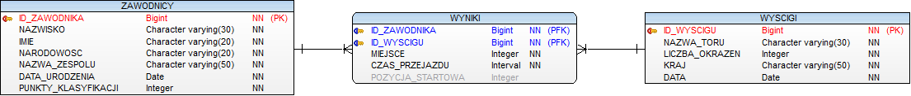

# Data Definition (DDL) · T4/A — Formula 1 tables

> Course: SQL
> Date: 2026-11-23

[← Data Definition (DDL)](../../README.md)

## Task

### 🇵🇱 Treść zadania (PL)

W schemacie **formula1** utwórz następujące tabele, określając więzy integralności oraz właściwe typy danych poszczególnych atrybutów:

- W każdej tworzonej tabeli zdefiniuj odpowiednie ograniczenia więzów integralności:
  - kluczy podstawowych/głównych (PRIMARY KEY);
  - kluczy obcych (FOREIGN KEY).
- Tabele powinny posiadać zdefiniowane następujące ograniczenia:
  - kolumna ID_ZAWODNIKA w tabeli ZAWODNICY jest liczbą całkowitą, dodatnią o maksymalnej wartości 999 999 oraz kluczem podstawowym zdefiniowanym "in-line";
  - kolumna ID_WYSCIGU w tabeli WYSCIGI jest liczbą całkowitą, dodatnią o maksymalnej wartości 999 oraz kluczem podstawowym zdefiniowanym "in-line";
  - kolumna ID_ZAWODNIKA w tabeli WYNIKI jest elementem klucza podstawowego o nazwie WYNIKI_PK a także kluczem obcym o nazwie WYNIKI_ID_ZAWODNIKA_FK, wskazującym na kolumnę ID_ZAWODNIKA w tabeli ZAWODNICY;
  - kolumna ID_WYSCIGU w tabeli WYNIKI jest elementem klucza podstawowego o nazwie WYNIKI_PK a także kluczem obcym o nazwie WYNIKI_ID_WYSCIGU_FK, wskazującym na kolumnę ID_WYSCIGU w tabeli WYSCIGI;
  - kolumny MIEJSCE i POZYCJA_STARTOWA powinny przechowywać wartości liczbowe dodatnie, całkowite o maksymalnej wartości 999;
  - kolumna PUNKTY_KLASYFIKACJI i LICZBA_OKRAZEN powinny przechowywać wartości liczbowe nieujemne, całkowite o maksymalnej wartości 100.

### 🇬🇧 Task description (EN)

In the **formula1** schema, create the following tables, defining the integrity constraints and the proper data types of the attributes (see the ERD above):

- In every table, define the appropriate integrity constraints:
  - primary keys (PRIMARY KEY);
  - foreign keys (FOREIGN KEY).
- The tables should have the following constraints:
  - column ID_ZAWODNIKA (competitor ID) in table ZAWODNICY (competitors) is a positive integer with a maximum value of 999 999 and a primary key defined in-line;
  - column ID_WYSCIGU (race ID) in table WYSCIGI (races) is a positive integer with a maximum value of 999 and a primary key defined in-line;
  - column ID_ZAWODNIKA in table WYNIKI (results) is part of the primary key named WYNIKI_PK and also a foreign key named WYNIKI_ID_ZAWODNIKA_FK, referencing column ID_ZAWODNIKA in table ZAWODNICY;
  - column ID_WYSCIGU in table WYNIKI is part of the primary key named WYNIKI_PK and also a foreign key named WYNIKI_ID_WYSCIGU_FK, referencing column ID_WYSCIGU in table WYSCIGI;
  - columns MIEJSCE (place) and POZYCJA_STARTOWA (starting position) should store positive integers with a maximum value of 999;
  - columns PUNKTY_KLASYFIKACJI (classification points) and LICZBA_OKRAZEN (number of laps) should store non-negative integers with a maximum value of 100.

## Files

| File           | Description |
| -------------- | ----------- |
| `solution.sql` | Creates the `competitors`, `races` and `results` tables |
| `erd.png`      | ERD from the task sheet |
